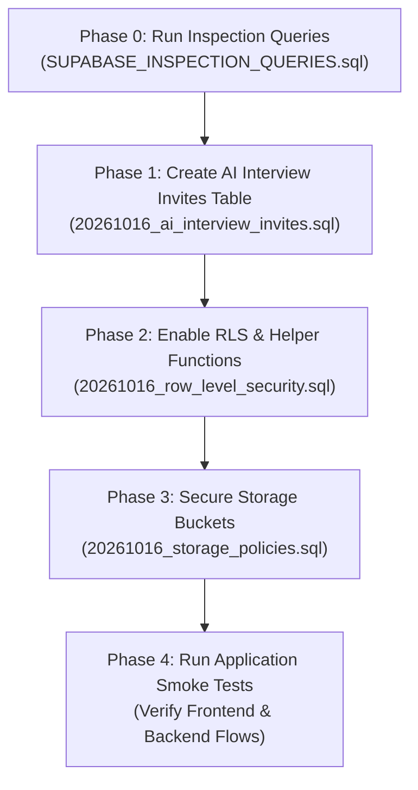

# SaarthiCampus — Supabase Migration & Security Runbook

**Audience:** SaarthiCampus Developers & Database Administrators
**Difficulty:** Beginner-friendly
**Estimated Time:** 15–20 minutes
**Safety Status:** Non-destructive (no data deletion, no table drops)

---

## 1. Important Rules & Preparation

Before you run any SQL in your Supabase dashboard:
1. **Never run destructive commands:** Do not use `DROP TABLE`, `TRUNCATE`, or `ALTER TABLE ... DROP COLUMN` on live data.
2. **Always take a backup:** If you are on a paid Supabase plan, verify your automatic backups or take an instant snapshot in the Supabase Dashboard under **Database -> Backups**.
3. **Run scripts step-by-step:** Do not run all scripts at once. Run one file at a time, check the result, and verify before moving to the next.
4. **Where to run SQL scripts:**
   - Log in to your [Supabase Dashboard](https://supabase.com/dashboard).
   - Select your **SaarthiCampus** project.
   - Click on **SQL Editor** in the left sidebar.
   - Click **+ New query**, paste the SQL content, and click **Run**.

---

## 2. Migration Execution Order



---

## 3. Step-by-Step Instructions

### Phase 0: Pre-Flight Inspection (Read-Only)
* **File:** `SUPABASE_INSPECTION_QUERIES.sql`
* **Purpose:** Inspect current tables, RLS states, and existing policies before making changes.
* **Instructions:**
  1. Open `SUPABASE_INSPECTION_QUERIES.sql` in your code editor.
  2. Copy queries 1 through 5.
  3. Paste into the Supabase SQL Editor and click **Run**.
  4. Note the tables where `rls_enabled` is `false`.

---

### Phase 1: Create `ai_interview_invites` Table
* **File:** `supabase/migrations/20261016_ai_interview_invites.sql`
* **Purpose:** Adds the invitation tracking table required by the AI interview pipeline.
* **Instructions:**
  1. Open `supabase/migrations/20261016_ai_interview_invites.sql`.
  2. Copy the entire file content.
  3. In Supabase SQL Editor, paste and click **Run**.
  4. **Expected Result:** `Success. No rows returned.`
* **Verification Query:**
  ```sql
  SELECT table_name, column_name, data_type
  FROM information_schema.columns
  WHERE table_name = 'ai_interview_invites';
  ```
  *You should see 9 columns (`id`, `candidate_id`, `job_id`, `token`, `status`, `created_at`, `started_at`, `completed_at`, `expires_at`).*
* **Rollback (if needed):**
  If something went wrong, run `supabase/migrations/20261016_rollback_ai_interview_invites.sql`.

---

### Phase 2: Enable Row Level Security (RLS) & Helper Functions
* **File:** `supabase/migrations/20261016_row_level_security.sql`
* **Purpose:**
  1. Installs non-recursive security helper functions (`get_current_user_role()`, `is_user_approved()`, `get_current_user_company_id()`).
  2. Enables RLS and sets access policies across all 38 application tables.
* **Instructions:**
  1. Open `supabase/migrations/20261016_row_level_security.sql`.
  2. Copy the entire content.
  3. In Supabase SQL Editor, paste and click **Run**.
  4. **Expected Result:** `Success. No rows returned.`
* **Verification Query:**
  ```sql
  SELECT tablename, rowsecurity
  FROM pg_tables
  WHERE schemaname = 'public' AND rowsecurity = false;
  ```
  *Expected result: 0 rows (all public tables now have RLS enabled).*
* **Rollback (if needed):**
  If any policy blocks desired application behavior, run `supabase/migrations/20261016_rollback_row_level_security.sql`.

---

### Phase 3: Secure Storage Buckets & Policies
* **File:** `supabase/migrations/20261016_storage_policies.sql`
* **Purpose:**
  1. Makes `candidate-documents` (KYC, marksheets) private.
  2. Adds RLS policies for `resumes`, `Resumes`, and `candidate-photos` allowing public upload during student job applications while restricting viewing/deletion.
* **Instructions:**
  1. Open `supabase/migrations/20261016_storage_policies.sql`.
  2. Copy the entire content.
  3. In Supabase SQL Editor, paste and click **Run**.
  4. **Expected Result:** `Success. No rows returned.`
* **Verification Query:**
  ```sql
  SELECT policyname, cmd, roles
  FROM pg_policies
  WHERE schemaname = 'storage' AND tablename = 'objects';
  ```
  *You should see policies for student resume upload, staff resume management, and candidate photo access.*
* **Rollback (if needed):**
  If file uploads fail, run `supabase/migrations/20261016_rollback_storage_policies.sql`.

---

## 4. Phase 4: Application Smoke Testing Checklist

After applying the migrations, perform these checks to confirm the live application functions normally:

| Test Item | Action | Expected Result | Pass? |
|---|---|---|:---:|
| **1. Public Application** | Navigate to `/apply`, select an open job, fill form, upload resume and photo, submit. | Application succeeds with confirmation message. Resume uploaded to bucket. | [ ] |
| **2. Recruiter Login** | Log in with staff account (`admin` or `recruiter`). Open Candidate Database. | Candidate list loads. Resumes and photos open properly. | [ ] |
| **3. Corporate Login** | Log in with corporate account. View candidates and save one. | Candidate bookmarks succeed (`saved_candidates` record created with `company_id`). | [ ] |
| **4. AI Interview Invite** | From recruiter dashboard, send AI interview invitation to an applicant. | Invite generated, stored in `ai_interview_invites`. | [ ] |
| **5. Student AI Interview** | Open `/interview/:token` in incognito window. Complete greeting round. | Starts session, sends message, receives LLM reply. | [ ] |
| **6. Aptitude Test** | Open `/aptitude-test/:token` in incognito window. Submit answers. | Test submits and saves score without error. | [ ] |
| **7. Signed Document View** | In candidate passport, view candidate uploaded documents. | Backend generates secure signed URL for `candidate-documents`. | [ ] |

---

## 5. Troubleshooting Guide

### Issue: "infinite recursion detected in policy for relation 'profiles'"
* **Cause:** A policy on the `profiles` table is querying `FROM profiles` directly.
* **Fix:** Ensure you ran the helper functions from `20261016_row_level_security.sql` (`get_current_user_role()`, etc.). These functions are `SECURITY DEFINER` and bypass the recursive policy check.

### Issue: "column saved_candidates.company_user_id does not exist"
* **Cause:** Running outdated backend or frontend code that expected `company_user_id`.
* **Fix:** Verify you are running the latest code from `recruitos-backend/index.js` and `recruitos-frontend/src/lib/api.js` where `company_id` is used.

### Issue: "relation 'ai_interview_invites' does not exist"
* **Cause:** Phase 1 migration has not been applied to your Supabase project yet.
* **Fix:** Run `supabase/migrations/20261016_ai_interview_invites.sql` in the Supabase SQL Editor.

### Issue: Resume images or links fail to load with HTTP 400 or 403
* **Cause:** The `resumes` bucket was set to `public = false` before frontend components were updated to use signed URLs.
* **Fix:** Run the following SQL query in Supabase SQL Editor to restore public read access to resumes while maintaining insert policies:
  ```sql
  UPDATE storage.buckets SET public = true WHERE id IN ('resumes', 'Resumes', 'candidate-photos');
  ```
